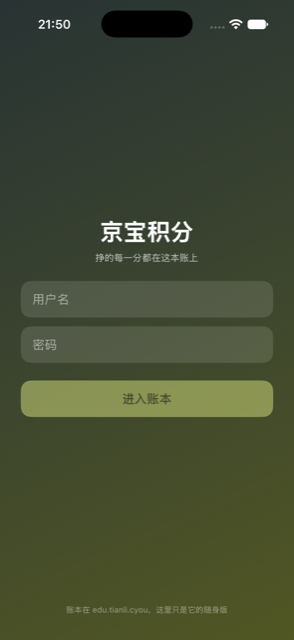
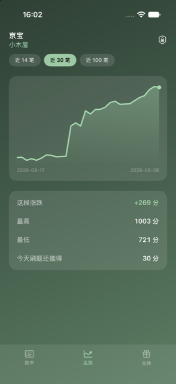
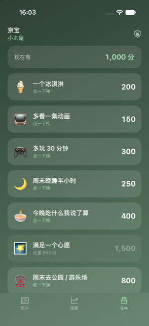
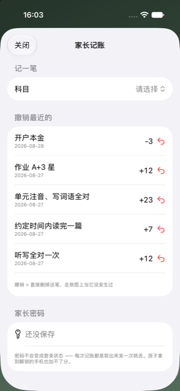
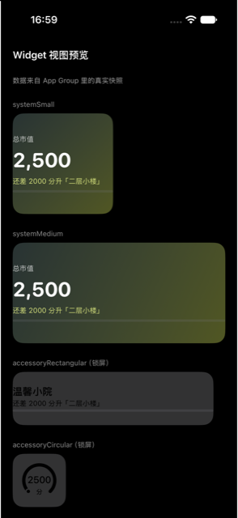
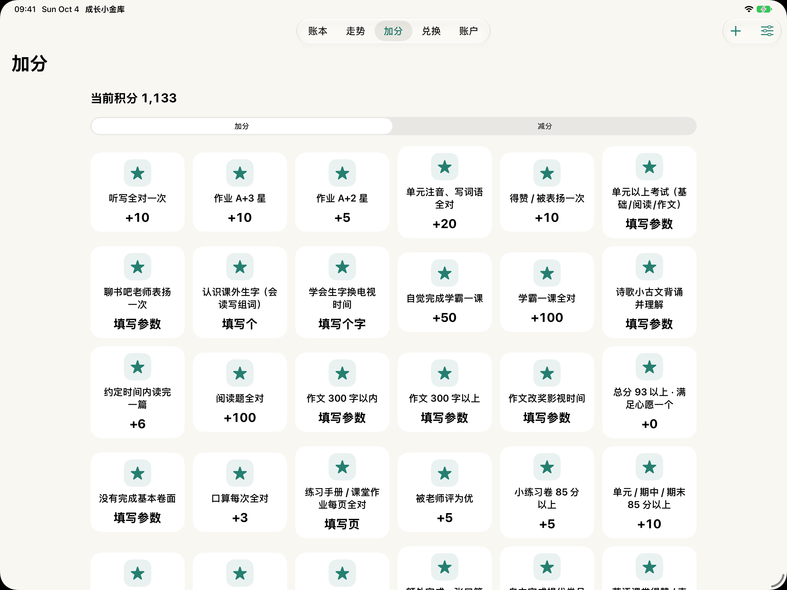
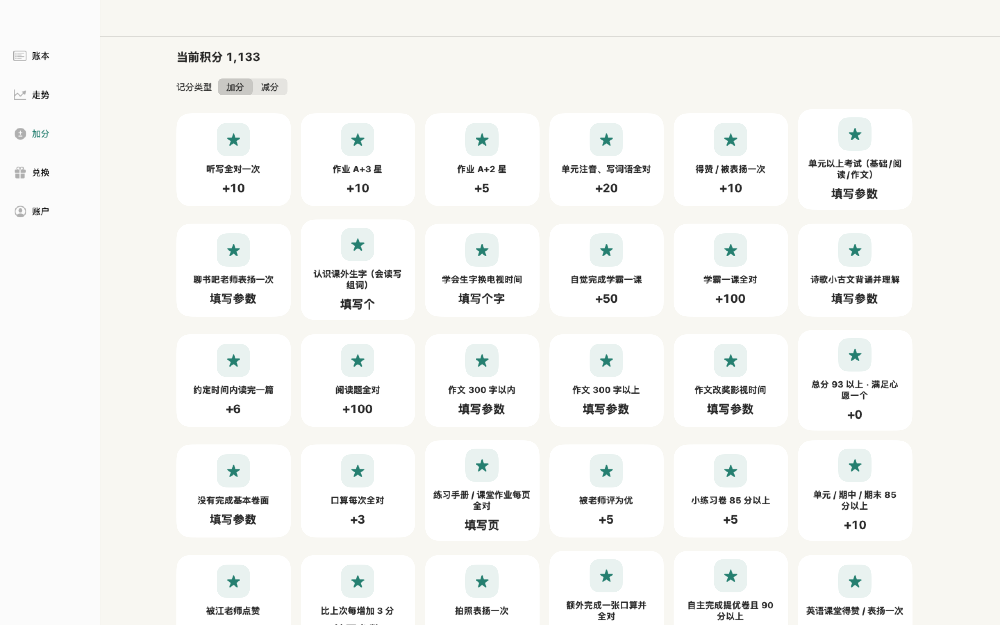
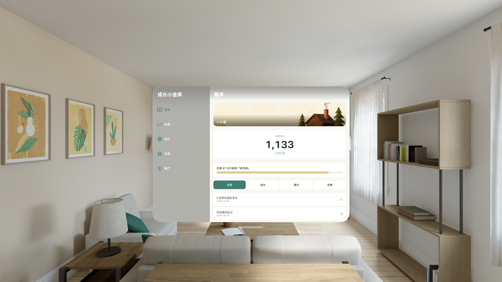
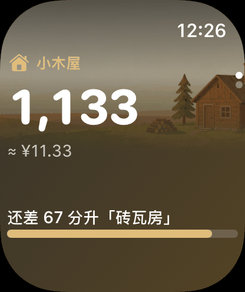

**中文** | [English](README_EN.md)

<p align="center"></p>

# Growth Treasury · 成长小金库

**孩子的每一分努力，涨成看得见的房子。**

   [](https://apps.apple.com/app/id6806799638) 

由家长操作的家庭积分账本：记录表现、积攒约定奖励，让每一份努力看得见。客户端沿用共享 API 与服务端规则，11 档成长家园和 5 个时代插画保留。

本地源码已按 [PRD 1.3](../PRD.md) 改为五栏目与一键记分，接入邮箱与手机号账号流程。VPS Mailu 邮件已真实收信核验；阿里云短信尚待云端配置与产品真实投递验收。新版后端已上线，TestFlight **1.0.2（11）** 已通过 Apple 处理并进入 family 内测组；未提交商店审核。开头手机截图保留此前版本，下面四平台图片为本轮真实采集；资源表只显示绑定当前输入的实测。平台行为与环境见 [验收记录](perf/platform-validation/README.md)，开发状态见 [交接](handoffs/prd-1.2-20261004.md)。

<p>以下为此前发行版截图；改版实机/模拟器画面见交接中的原始证据。</p>
<table><tr>
<td align="center" width="25%"><br><sub>开屏：挣的每一分都在这本账上——整页配色跟着当前住的房子走</sub></td>
<td align="center" width="25%"><br><sub>走势：积分市值像股票一样有曲线，最高最低、今天刷题还能得几分</sub></td>
<td align="center" width="25%"><br><sub>兑换：冰淇淋、多玩 30 分钟、满足一个心愿——花自己挣的分，不许透支</sub></td>
<td align="center" width="25%"><br><sub>家长记一笔：选规则、看预览、输密码；撤销最近的直接删，走势图上当它没发生过</sub></td>
</tr></table>

<details><summary>更多截图</summary><table><tr>
<td align="center" width="25%"><br><sub>五个时代的插画与从中采样派生的整页配色</sub></td>
<td align="center" width="25%"><br><sub>Widget 视图预览（App 内渲染）：市值常驻，还差多少升下一档</sub></td>
</tr></table></details>

## 它做什么

| 栏目 | 当前源码功能 |
|---|---|
| 账本 | 当前积分、成长家园、四类流水筛选、详情与撤销；历史数据保留 |
| 走势 | 近 7 天、30 天、全部；读取服务端余额快照 |
| 加分 | 加减分卡片、一键固定分、服务端参数预览、临时记录、项目管理 |
| 兑换 | 奖励管理、一次确认价格与兑换后余额；不透支 |
| 账户 | 手机和邮箱验证、绑定换绑、设置或修改密码、找回、资料导出、帮助与注销回执 |

## 一个 App，五个平台

同一个名字、同一个图标、同一本账：iPhone、iPad、Mac、Apple Vision Pro 是同一个 target，Apple Watch 是随 iPhone 包一起装的手表 App。账本都在服务端，哪台设备记的分，别的设备下拉或回到前台就看到。

| 平台 | 长什么样 | 现在能不能装 |
|---|---|---|
| iPhone | 当前源码为底部五栏：账本 / 走势 / 加分 / 兑换 / 账户；含锁屏和桌面小组件 | [App Store](https://apps.apple.com/app/id6806799638) 中国区在售 1.0.2、免费，2026-10-09 Apple 公开接口回读；设备实装构建号未核 |
| iPad | 同顺序底部五栏；宽屏增加卡片列数，分屏按可用宽度排布 | 在售的是同一个包；TestFlight 1.0.2（11）可测试新版 |
| Mac | 原生 macOS 窗口，同顺序五项侧栏；包内自带 `treasury` 命令行 | **未上架**；本地测试包在 `build/accept/mac/Growth Treasury.app` |
| Apple Watch | 抬腕看住在哪一档、余额、还差几分升级与进度，翻一页是最近 10 笔；表盘复杂功能四种。只读，不兑换、不记账；登录态由 iPhone 递过来 | 随 TestFlight 1.0.2（11）嵌入 iPhone 包；独立 Watch 商店上架未完成 |
| Apple Vision Pro | 同一套侧栏看板放在系统玻璃窗口里，时代色只做强调色 | **未上架**，只在模拟器上验过 |

<table><tr>
<td align="center" width="50%"><br><sub>iPad 横屏：五栏导航与加分卡片（模拟器截图）</sub></td>
<td align="center" width="50%"><br><sub>Mac：五项侧栏与加分卡片（本机截图，窗口未激活）</sub></td>
</tr><tr>
<td align="center" width="50%"><br><sub>Apple Vision Pro：玻璃窗口里的账本看板（模拟器完整画面）</sub></td>
<td align="center" width="50%"><br><sub>Apple Watch：住在哪一档、余额、还差几分升级（模拟器截图）</sub></td>
</tr></table>

截图里的账号「小满」和 30 天流水是演示数据（`scripts/demo/ledger.py` 在本机临时起的隔离账本），不是任何真实家庭的账。

### 各平台资源占用（模拟器与本机实测）

<!-- platforms:start -->
| 平台 | 测量环境 | 包体／安装 | 空闲内存 | 空闲 CPU | 冷启动到首屏有数据 | 测量时负载（1 / 5 / 15 分钟） | 目标 |
|---|---|---|---|---|---|---|---|
| iPhone | 当前版本未测（旧原件保留） | — | — | — | — | — | ≤ 100 MiB · ≤ 0.5% · ≤ 20 MB 包 · ≤ 5 s |
| iPad | 模拟器 · iPad Pro 13-inch · iPadOS 27.0 | 9.0 MB zip | 31.0 MiB | 0% | 0.90 s | 38.8 / 27.0 / 36.4 | ≤ 120 MiB · ≤ 0.5% · ≤ 25 MB 包 · ≤ 5 s |
| Mac | 本机原生 · Mac16,12 / Apple M4 · macOS 27.2 | 13.1 MB 安装 | 42.0 MiB | 0% | 0.45 s | 4.7 / 11.0 / 19.2 | ≤ 150 MiB · ≤ 0.5% · ≤ 30 MB 安装 · ≤ 3 s |
| Apple Watch | 模拟器 · Apple Watch Series 12 · watchOS 27.0 | 3.0 MB zip | 23.0 MiB | 0% | 0.77 s | 9.5 / 17.5 / 23.3 | ≤ 25 MiB · ≤ 0.5% · ≤ 10 MB 包 · ≤ 1.5 s |
| Apple Vision Pro | 模拟器 · Apple Vision Pro · visionOS 27.0 | 5.4 MB zip | 49.0 MiB | 0.05% | 7.48 s | 17.0 / 20.8 / 21.3 | ≤ 60 MiB · ≤ 0.5% · ≤ 30 MB 包 · ≤ 10 s |

<sub>**这些数字是在本机重负载下测的**：各线开始计时启动前，宿主（10 核）1 分钟负载 4.7–38.8、5 分钟 11.0–27.0、15 分钟 19.2–36.4（每行的「测量时负载」），部分负载高于核数；测量门要求 1 分钟负载低于核数的 1.5 倍。冷启动最受宿主负载影响，表里的启动时间很可能偏悲观（偏慢），空闲时重测会更低。2026-10-04 实测，数据来自 `perf/platforms/<平台>.json`。iPhone / iPad / Watch / Vision 是 Xcode 模拟器上的 Release 构建，Mac 是本机原生的本地 Release 构建；**移动平台不是实机数值，包体不是 App Store 切片**。本表仅统计 App 宿主，不含 WebKit/XPC 与系统进程合计。内存为 App 进程 phys_footprint（MiB），CPU 为启动静置 45 秒后 60 秒窗口内的 CPU 时间 ÷ 墙钟，冷启动是发出启动到 App 打出「第一屏有数据」日志的中位数（隔离的本地演示账本，5 次，丢弃装机后第一次）。模拟器的启动时间随宿主负载浮动很大：2026-10-02 本机内存吃紧时，同一份代码的 iPhone 线在不同时段测出 1.8–4.1 秒；Vision Pro 的冷启动里模拟器自己的开销（进程拉起后到 App 打出第一行日志、visionOS 场景与 RealityKit 初始化）占大头，宿主忙时会拉长到十几秒，App 自己从取账本到画出第一屏约 2 秒。</sub>
<!-- platforms:end -->

## 怎么拿到

已支持手机验证码、邮箱注册与独立家庭账本；iPhone / iPad 版已在 [App Store](https://apps.apple.com/app/id6806799638) 发布，Mac、Apple Watch、Apple Vision Pro 版还没上架。2026-10-09 Apple 中国区公开接口回读在售 1.0.2、免费下载、iOS 18 起，见[公开版本回读](perf/raw/promo-apple-public-20261009.json)。[发行记录](perf/asc-release.json) 顶层仍是历史 TestFlight 1.0.2（11），本轮未修改；在售构建号、手机当前实装版本与真机性能未核验，历史资源数字不代表当前公开包。

时代插画底图来自作者的 `~/Apps/edu/web` 内容库（构建时同步进包），账本后端 `edu.tianli.cyou`。没有那份内容库，构建会停在 preBuildScripts。

## 给 Agent 的命令行 · `treasury`

App 给人用，命令行给 Agent 用。`cli/treasury` 是同一个服务端（`edu.tianli.cyou` 的 `/api/*`，App 与网页用的同一套接口）的薄客户端，只用 Python 标准库；分值、档位解锁、透支、账号权限和并发锁全在服务端判，命令行里没有一行算分逻辑。

本机构建的 Mac 版 `.app` 自带这个命令：`Contents/Resources/bin/treasury`（`project.yml` 的构建阶段只在 macOS 的 build 里拷进去，随包签名）；iPhone/iPad 包和任何归档（App Store / TestFlight）都不带。

```bash
sh cli/install.sh          # 装了 Mac 版：按 bundle id 找到 .app，链到包里的命令；没装：链到本仓 cli/treasury（改源码即生效）
sh cli/install.sh --check  # 只核对；--uninstall 只删本产品入口的链接
```

凭据只从环境变量或 stdin 取，不落盘、不回显：`EDU_USER`（邮箱或用户名）、`EDU_PASSWORD`（或 `--password-stdin`）；日常记账无需第二套家长密码；仅旧站点管理命令使用独立 `EDU_PARENT_PW`（或 `--parent-stdin`）；`EDU_API_BASE` 默认 `https://edu.tianli.cyou`。

```bash
treasury version --json                        # 不登录：命令行版本、所在 App 的版本、服务端连不连得上
treasury state --json                          # 余额、住哪一档、还差多少升档、电视时间、心愿、今天刷题额度
treasury entries --limit 10 --json             # 流水（新的在前；服务端下发最近 400 笔）
treasury entries --all --filter redeem --limit 0 --json   # 全部兑换记录（--all 取 400 笔之前的）
treasury export --out ledger.json --json       # 导出整本账（同 App「导出账本」）
treasury preview tr-show --json                # 服务端算分，不记账
treasury earn tr-show --request-id example-operation-0001 --json
treasury spend sh-icecream --dry-run --json    # 先看能不能换
treasury config get --json
# revision 使用刚读取并编辑的配置版本
treasury config put shop --file shop.json --revision "$REVISION" --json
```

读命令都支持 `--json`，输出 `{"ok": true, …}`；失败输出 `{"ok": false, "err": …}` 且退出码非 0（1 = 服务端拒绝或网络失败，2 = 用法错或缺凭据）；失败输出另带 `error: {code, message}`（`usage` / `rejected` / `failed`），参数写错时带 `--json` 也按这个形状输出。读、写命令的完整清单、退出码表和仅在窗口中的项见 `treasury --help`。读命令不改任何状态；会写的命令都走服务端原有的校验、锁与幂等，记账/调账/撤销/兑换可先 `--dry-run`，删号与注销必须 `--yes`。

| App 里能做的 | 命令 |
|---|---|
| 账本首页 | `treasury state` |
| 流水 / 走势 | `treasury entries [--since 日期] [--cur pts\|tv\|wish] [--filter all\|earn\|deduct\|redeem] [--all]` / `treasury trend --span 7\|30\|0`（0 为全部） |
| 兑换清单 / 兑换 | `treasury shop` / `treasury spend <商品>` |
| 家园阶梯 | `treasury tiers` |
| 导出账本 | `treasury export --out 文件` |
| 家长：规则、预览、记账、撤销、调账 | `treasury rules` / `preview` / `earn` / `undo` / `adjust` |
| 管理规则 / 商品 / 档位 | `treasury config get` / `treasury config put rules\|shop\|tiers --file items.json` |
| 资料、账号密码、邮箱、注销 | `treasury profile` / `me` / `account passwd\|code-send\|code-verify\|email-bind\|recover\|delete --yes\|delete-request --yes\|delete-status [--receipt 回执]` |
| 手机注册、登录、绑定与找回 | `treasury account phone-send\|phone-verify\|phone-register\|phone-login\|phone-bind\|phone-recover\|password-set`；OTP 与授权从 stdin 读 |
| 独立站点用户管理 | `treasury users list\|reset-password\|delete --yes` |

管理范围以服务端为准：`config get`、`config put`、`users list` 原样报告响应里的 `scope`（`site` 全站 / `account` 仅本账号）。服务端没返回 `scope` 时报 `unknown`：`users list` 只显示本账号自己这一行，`config put`、`users reset-password`、`users delete` 直接拒绝，不猜写入会落到哪里。

留在 App 的（纯界面）：实时刷新推送、离线缓存提示、桌面/锁屏小组件与手表复杂功能的摆放、升档庆祝动画、配色与小组件预览、政策阅读页与邮件链接。退出登录、设备偏好和系统商店更新使用设备自身入口，后端 treasury 不读取设备里的会话或偏好。基本功能的 CLI 验收与新进程读回见下文。

回归：`python3 Tests/cli_treasury_test.py` —— 先核打包规则与 `install.sh`（临时 Applications 目录里的假 .app），再起一个隔离的本地服务端（临时目录 + 空闲端口），不碰线上账号；需要同一工作区的 `edu/web/points/server.py`，或用 `EDU_SERVER_PY` 指过去。

## 构建

```bash
brew install xcodegen
xcodegen generate
xcodebuild -scheme PointsDeck -destination 'generic/platform=iOS Simulator' build        # iPhone / iPad（连同嵌入的手表 App）
xcodebuild -scheme PointsDeck -destination 'platform=macOS' build                        # Mac
xcodebuild -scheme PointsDeck -destination 'generic/platform=visionOS Simulator' build   # Apple Vision Pro
xcodebuild -scheme PointsDeckWatch -destination 'generic/platform=watchOS Simulator' build  # Apple Watch 单独编
```

- 仓里的 `*.sh` 是作者本机舰队脚本的 shim（三平台构建 / 真机装机 / TestFlight），依赖 `~/Dev` 下的总部工具，不在本仓；没有那套工具时它们会明确退出。
- `Shared/PlatformCompat.swift` 是总部共享文件的逐字节副本（iOS-only SwiftUI 修饰符在 macOS / visionOS / watchOS 侧的同名替身），别在这里改它。
- `bash Tests/check-platform-typecheck.sh`：手表与 Vision 的便宜编译车道（按 `project.yml` 各 target 的源码清单 `swiftc -typecheck`，不起模拟器）。
- `project.yml` 的 preBuildScripts 会跑 `sync-skins.sh`，从作者本机同步内容进包；没有那份内容时构建会停在这一步。

开发细节（回归、验证通道、约束）见 [DEVELOPING.md](DEVELOPING.md)。

## 相关

- 产品页：<https://apps.tianli.cyou/p/points-deck-ios.html>
- 舰队总览（10 个 app 怎么来的）：<https://apps.tianli.cyou/ios.html>
- 教程：[从零到 TestFlight：一个人做 iPhone app 的完整路径](https://blog-ai.tianli.cyou/nine-ios-apps-in-two-weeks)

## License

MIT © 2026 曾田力 (Tianli Zeng)

<!-- lightweight:start -->
## 资源占用

安装包为 App Store 数据；内存、CPU 与启动时间为 iOS 模拟器实测，不是真机数值。

| 安装包 | 空闲内存 | 空闲 CPU | 模拟器冷启动到有数据的首屏 |
|---|---|---|---|
| **3.1 MB**（装好后 4.0 MB） | **45.1 MB** | **0%** | **1.8 s** |

体积按具体发行构建回读；真机尚未测量，内存、CPU 与启动时间先用 iOS 模拟器实测并标明环境。

<sub>v1.0.1 (8) · iPhone 17（iPhone18,3）；体积为 Apple 设备切片记录，运行性能尚未真机实测 · 历史实测：体积来自 TestFlight 1.0.1 (8)，运行性能来自本地验收构建 1.0.1 (1) 的独立模拟器记录；上述数据不代表当前公开发行包。当前公开发行 App Store 1.0.2（2026-10-09 Apple 中国区公开接口回读，免费，iOS 18 起），在售构建号本轮未核实。历史模拟器启动采样前 1 分钟负载 14.17（10 核宿主），速度受当时负载影响。体积不含用户数据与后续缓存 · 2026-09-30。体积来自 Apple App Store Connect 对应构建的设备切片记录。内存、CPU 与启动时间是 iPhone 17 Pro (iPhone-17-Pro) / iOS 27.0 Simulator 上本地源码 Release 构建 v1.0.1 (1) 的实测（2026-10-02），只统计 App 进程，不等于真机数值；真机测量尚未完成。内存口径为 phys_footprint；CPU 为 60 秒采样窗内 CPU 时间 ÷ 墙钟；大小按十进制 MB。原始数据见 [perf/lightweight.json](perf/lightweight.json)。</sub>
<!-- lightweight:end -->


## 配置与 App 更新

新构建在登录页顶部及账户页提供「设置」，显示当前包的真实版本和构建号，并可选择启动栏目、升档庆祝、应用内刷新快捷键。连接键盘时 ⌘R 刷新，开关关闭后触屏刷新仍可用；不注册全局快捷键。

「同步、备份与更新」复用总部生命周期。iCloud 默认关闭，开启后仅同步这三项偏好，iOS 使用系统 KVS；支持 JSON 导出、导入及坏文件保留原配置。关闭不删除本机或云端配置。账号、访问凭据、账本、本机权限与缓存不在同步白名单。

「检查更新」读取本 App 的 App Store 发行版本；可前往系统商店页面升级，网络失败会显示原因。 此入口检查 App 版本，资料或后台数据刷新仍在原入口。

同工程的 Mac 构建通过 iCloud 私有发行包检查更新；只有实际发布到该渠道的安装包才会出现下载入口。

版本号更新属于本轮新构建；手机上的新版本需通过签名安装或原商店/TestFlight 渠道取得，发行状态以现有发布记录为准。

固定验收：`chapter sop accept --app points-deck-ios --check product_basics --json`。`scripts/accept/product_basics.py --app <候选.app> --receipt <sim_lane构建回执.json>` 明确验当前候选，默认无候选参数时验 `--udid` 上已装的模拟器包及其回执。验收使用全新无窗口模拟器、App 进程内真实设置控件与离屏截图、隔离账本、隔离配置往返和 App Store 更新源测试；`--basics-readback` 新进程读取保存值。14 项原件由 Chapter 核 SHA，iCloud 隔离链路不表示 Apple 跨设备传输已验证。本轮不装手机或 Mac、不发布。
